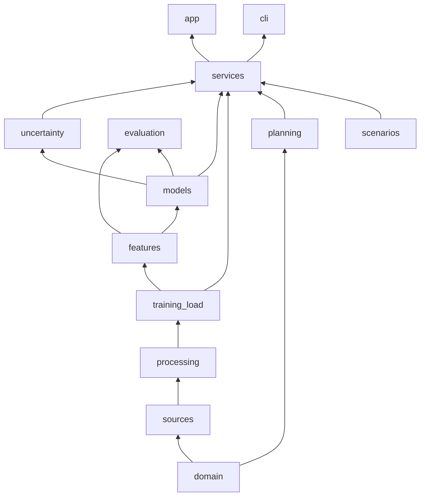
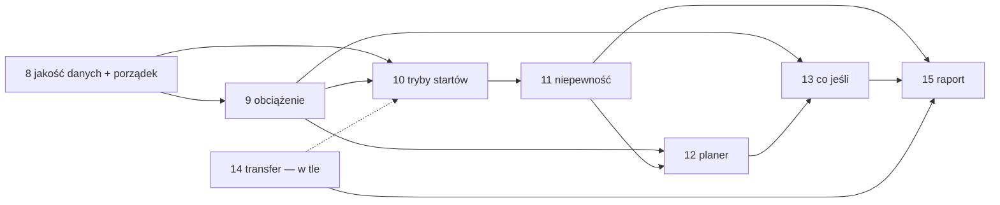

# Architektura rozszerzenia (etapy 8–15)

Uzupełnienie sekcji 8 w [PLAN_ROZSZERZENIA.md](PLAN_ROZSZERZENIA.md). Opisuje, **co powstaje, z czego korzysta i co
zmienia w istniejącym kodzie**, tak żeby kolejne etapy nie rozjechały się w bałagan.

---

## 1. Stan obecny: trzy miejsca, które trzeba naprawić najpierw

1. **Dwa różne czyszczenia danych.** Trening idzie przez `processing.default_pipeline()`, a aplikacja przez
   `predictor.prepare_activities()`: inne kroki, inne imputacje, tętno wymagane w jednym i opcjonalne w drugim. Model
   widzi w aplikacji inne dane niż przy treningu (*train/serve skew*), a każda nowa poprawka danych (np. filtry z
   analizy błędów) działa tylko w jednym z nich.
2. **`RacePredictor` robi wszystko.** Trzyma model, przedziały, porównanie z Riegelem, wyjaśnienia (sięgające do wnętrza
   `Pipeline` Ridge'a: `pipe[0]`, `pipe[1]`) i krzywą formy. Dokładanie tu planera, obciążenia i trybów zrobi z tego
   plik na 1000 linii.
3. **Kontrakty są nieopisane.** Aplikacja zależy od kolumn DataFrame'u zwracanego przez `predict()` (`time_s`,
   `low_s`, …), ale nic tego nie pilnuje.

Etap 8 zaczyna się od tych trzech rzeczy, zanim dojdzie jakakolwiek nowa funkcja.

---

## 2. Docelowa struktura i zasada warstw

```text
src/race_predictor/
├── domain/            # dataclasses: Activity, Race, + RaceMode, Goal, TrainingPlan, Session   [8, 12]
├── sources/           # bez zmian
├── processing/        # + cleaning.py: JEDNO czyszczenie dla treningu i predykcji               [8]
├── training_load/     # NOWE: trimp.py, state.py (CTL/ATL/TSB), banister.py                     [9]
├── features/          # dataset.py: + grupa cech obciążenia                                      [9]
├── models/            # + router.py (model per tryb startu), + riegel z korektą maratonu       [10]
├── uncertainty/       # NOWE: conformal.py                                                        [11]
├── evaluation/        # + raporty dla 9–11, 14
├── services/          # NOWE: fasady dla UI – prediction.py, training.py, planning.py           [8, 12, 13]
├── planning/          # NOWE: zones.py, feasibility.py, periodization.py, builder.py,           [12]
│                      #       pacing.py, ics.py
├── scenarios/         # NOWE: whatif.py                                                           [13]
├── predictor.py       # zostaje jako cienki alias na services.prediction (zgodność wsteczna)
├── cli.py             # + komendy: load, plan
└── app/               # streamlit_app.py → app/main.py + pages/ (Predict, Load, Plan, What-if) [12, 13]
```

**Zasada warstw:** moduł importuje tylko z warstw poniżej siebie. Pilnuje tego test `tests/test_architecture.py`,
który parsuje importy (`ast`) i failuje na złamaniu reguły.



Najważniejsze reguły:

- **`app/` i `cli.py` importują tylko `services/`.** Żadnych `models.*`, `features.*` w UI. Dzięki temu zmiana
  modelu czy cech nie dotyka interfejsu.
- **`planning/` nie zna modeli ML.** Dostaje przewidywany czas i stan obciążenia jako zwykłe liczby i dataclasses,
  więc reguły planu da się testować bez trenowania czegokolwiek.
- **`training_load/` to czyste funkcje na DataFrame'ie aktywności.** Nie zależy od cech ani modeli.

---

## 3. Kontrakty (to, czego nie wolno zmieniać po cichu)

| Kontrakt | Gdzie | Pilnowane przez |
|---|---|---|
| Kanoniczna tabela aktywności (`sources.loader.COLUMNS`, jednostki SI) | `sources/` → wszyscy | istniejące testy źródeł + `validate_activities()` w `processing/cleaning.py` |
| Dzienny stan obciążenia: indeks `date`, kolumny `trimp, ctl, atl, tsb` | `training_load.state` | testy jednostkowe na znanych przykładach |
| `RaceModel.fit/predict` (tempo s/km) | `models/base.py` | bez zmian |
| `Prediction` (dataclass): `distance_m, time_s, low_s, high_s, coverage, model, mode` | `services/prediction.py` | test kontraktu, a `predict()` zwraca też DataFrame z tymi kolumnami dla zgodności |
| `TrainingPlan` → lista `Week` → lista `Session` (dataclasses) | `domain/` | testy reguł planu |

---

## 4. Etapy: co powstaje, z czego korzysta, co zmienia

### Etap 8: jakość danych i porządek (fundament)

- **Nowe:**
  - `processing/cleaning.py`: `cleaning_pipeline(purpose: Literal["train", "predict"])`. Wspólne kroki (anomalie,
    filtr szybkich biegów, skoki tętna, HRmax) plus różnice zależne od celu: `train` wyrzuca zawodników bez
    tętna, `predict` imputuje.
  - `services/prediction.py`: `PredictionService` + dataclass `Prediction`.
  - `tests/test_architecture.py`.
- **Zmienia:**
  - `runner.load_dataset` i `predictor.prepare_activities` wołają `cleaning_pipeline(...)`. Stara
    `prepare_activities` zostaje jako alias.
  - `RacePredictor` przechodzi do `services/prediction.py`, a `predictor.py` tylko go re-eksportuje, więc app i
    CLI działają bez zmian.
  - `explain()` przestaje grzebać w `pipe[0]`: model Ridge dostaje metodę `contributions(ds)`.
- **Dane:** decyzja o filtrze skoków tętna (+33 startów) po ręcznym przejrzeniu (lista do sprawdzenia generuje
  skrypt). Przegląd 50 startów o niestandardowym dystansie.
- **Korzysta z:** PR z analizą błędów (#3).
- **Gotowe, gdy:** jedno czyszczenie w całym kodzie, test kontraktu `Prediction`, test warstw, wyniki bazowe
  przeliczone skryptami.

### Etap 9: obciążenie treningowe

- **Nowe (`training_load/`):**
  - `trimp.py`: TRIMP Banistera z `moving_s`, `avg_hr`, `hr_max` i tętna spoczynkowego (szacowane albo stałe).
    Treningi bez tętna dostają obciążenie z czasu i typu (fallback), jawnie oznaczone.
  - `state.py`: dzienna seria i wykładnicze średnie: CTL (42 dni), ATL (7 dni), TSB = CTL − ATL. Generator dni,
    bez pętli po DataFrame'ie.
  - `banister.py`: indywidualne dopasowanie modelu impulse–response (k₁, k₂, τ₁, τ₂) do startów zawodnika
    (`scipy.optimize`). Przy małej liczbie startów fallback do parametrów z literatury.
- **Zmienia:** `features/dataset.py` → `_example()` dostaje grupę cech `load` (CTL, ATL, TSB w dniu startu, rampa CTL
  z 4 tygodni). Nazwy w nowej liście `LOAD_FEATURES`. `STATIC_NUMERIC` się nie zmienia, więc modele z etapów 2–5 i ich
  wyniki zostają porównywalne. Nowe cechy dochodzą przez `tabular_columns`, z przełącznikiem.
- **Korzysta z:** etap 8 (poprawny HRmax).
- **Eksperyment:** `experiments/run_training_load.py` → `docs/RESULTS_TRAINING_LOAD.md`. Czy TSB/CTL poprawiają
  predykcję (z rozbiciem na zwykłe starty i triathlon) i jak dobrze model Banistera opisuje formę.
- **UI:** strona *Load*: wykres CTL / ATL / TSB.

### Etap 10: tryby startów

- **Nowe:**
  - `domain.RaceMode` (`ROAD`, `TRIATHLON`, `TRAIL`).
  - `models/router.py`: `ModeRouter(RaceModel)` trzyma osobny model dla każdego trybu i wybiera go po
    `is_triathlon` / przewyższeniu (wzorzec Strategy). Domyślnie: `ROAD` = Riegel z korektą maratonu, `TRIATHLON` =
    Ridge, `TRAIL` = `ROAD` + korekta na przewyższenie uczona na danych.
  - `models/baselines.py`: `RiegelMarathonCorrected` z wykładnikiem zależnym od dystansu, uczonym na treningu.
- **Zmienia:** `PredictionService` używa `ModeRouter` zamiast samego Ridge. `build_query_dataset` dostaje parametr
  `mode` (dziś na sztywno `is_triathlon=0`).
- **Korzysta z:** `evaluation/breakdown.py` (#3), żeby wybór modelu per tryb był oparty na wynikach.

### Etap 11: niepewność

- **Nowe:** `uncertainty/conformal.py`: `ConformalRegressor(RaceModel)` opakowuje dowolny model.
  Reszty out-of-fold z podziałem po zawodnikach, kwantyle względne (przedział mnożnikowy jak dziś), osobno dla każdego
  trybu (Mondrian conformal).
- **Zmienia:** `PredictionService` zastępuje obecne `ratio_low_/ratio_high_`, które w praktyce już są prostą wersją
  tego samego, przez `ConformalRegressor`.
- **Eksperyment:** pokrycie przedziałów 80 % / 90 % na nowych zawodnikach (czy jest faktycznie ~80 %) →
  `docs/RESULTS_UNCERTAINTY.md`.

### Etap 12: planer celu

- **Nowe (`planning/`), czyste funkcje i dataclasses, bez ML:**
  - `zones.py`: tempa stref (easy / tempo / interwały / długie) z przewidywanego czasu na 10 km (tabele w stylu
    Danielsa).
  - `feasibility.py`: cel kontra przewidywanie z przedziałem plus typowe tempo poprawy w danych dla podobnego CTL.
    Wynik: „realny / ambitny / mało realny”.
  - `periodization.py`: podział tygodni do startu na fazy (baza, budowanie, szczyt, taper) zależnie od dystansu
    i czasu do startu.
  - `builder.py`: `PlanBuilder` (wzorzec Builder) składa plan z faz, startowego kilometrażu (z danych) i reguł
    bezpieczeństwa (≤ 10 % / tydz., tydzień odciążenia co 3–4 tygodnie, taper 1–3 tyg.). Tygodnie generowane
    leniwie (generator).
  - `pacing.py`: międzyczasy na dzień startu (równe tempo lub lekki negative split, korekta na przewyższenie).
  - `ics.py`: eksport planu do kalendarza.
- **Zmienia:** nic w istniejących modułach. Nowy `services/planning.py` łączy przewidywanie (etapy 10–11) i obciążenie
  (etap 9) z `planning/`. W UI strona *Plan*, w CLI `race-predictor plan --goal "10k 45:00" --date 2027-04-12`.
- **Testy:** reguły planu (progresja, taper, suma kilometrów) na stałych danych wejściowych, bez modeli.

### Etap 13: symulacje „co jeśli”

- **Nowe:** `scenarios/whatif.py`: `Scenario` (dataclass ze zmianami, np. `weekly_km × 1.15`, `+1 long run /
  week`) i funkcja, która z historii aktywności tworzy zmodyfikowaną przyszłą historię (generator syntetycznych
  treningów) i przepuszcza ją przez `PredictionService` i model Banistera.
- **Zmienia:** nic. Strona *What-if* w UI korzysta z `services/`.
- **AML:** analiza wrażliwości i wyjaśnienia kontrfaktyczne. W raporcie jawne zastrzeżenie o korelacji (14 osób).

### Etap 14: transfer learning (niezależny, w tle)

- **Korzysta z istniejącego** `sources/kaggle.py`, `features/kaggle.py`, `models/transfer.py`. Nowego kodu
  prawie nie ma: pobranie danych, uruchomienie, raport `docs/RESULTS_TRANSFER.md` z rozbiciem z #3.
- **Zmienia:** jeśli pretrening wygra na którymś trybie, model trafia do `ModeRouter` z etapu 10 jako opcja.
  W przeciwnym razie zostaje jako wynik negatywny w raporcie.

### Etap 15: raport i prezentacje

- Skrypty `experiments/` odtwarzają wszystkie tabele. Raport zbiera `docs/RESULTS_*.md`, a prezentacja na Advanced
  Python opisuje architekturę z tego dokumentu (warstwy, wzorce, kontrakty).

---

## 5. Kolejność i zależności



Etap 14 to głównie czas obliczeń, więc startuje od razu i liczy się w tle. Etap 8 blokuje wszystko inne, dlatego idzie
pierwszy.

---

## 6. Zasady pracy (żeby nie zrobił się bałagan)

1. **Jeden etap = jeden branch = jeden PR** do `main` forka. Na `main` nie pushujemy bezpośrednio. Duży etap dzielimy na
   2–3 mniejsze PR-y (np. 9a `trimp+state`, 9b `banister`, 9c cechy i eksperyment).
2. **CI zielone przed merge:** `ruff check`, `ruff format --check`, `pytest` (z TF w osobnym jobie, jak teraz).
3. **Każdy wynik pochodzi ze skryptu** w `experiments/` → `docs/RESULTS_*.md`. Żadnych liczb wpisanych ręcznie poza
   sekcją *Conclusions*. Zmiana czyszczenia danych oznacza przeliczenie wyników, których dotyczy, i wzmiankę w PR.
4. **Nowa logika nie trafia do notebooków ani do `app/`.** UI tylko wyświetla to, co zwracają `services/`.
5. **Zgodność wsteczna:** `RacePredictor`, `predict()` i `load_dataset()` działają jak dotąd, aż do jawnej zmiany
   w PR.
6. **README:** każdy etap dodaje wiersz w tabeli *What was built* i link do wyników.
