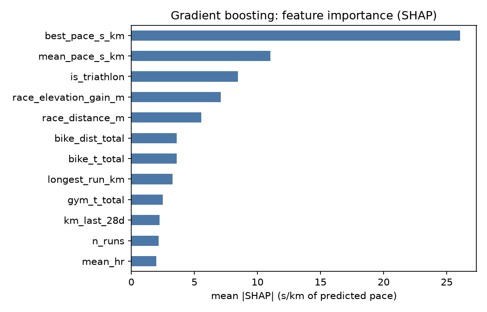
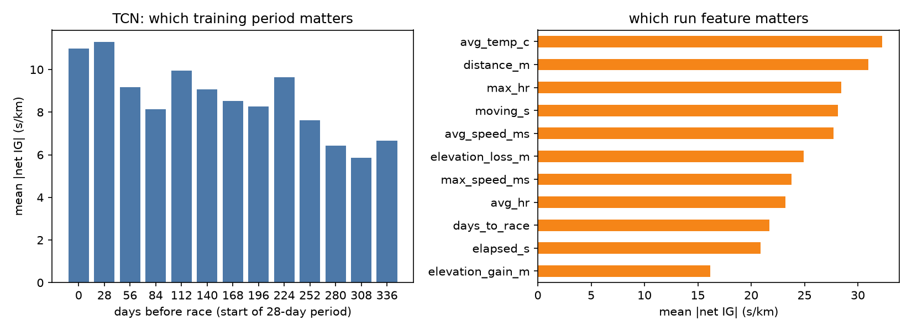

# Explainability

> **Note:** computed on the earlier 170-race set, before the manual race review (`REVIEW_RACES.md`); to be recomputed on the reviewed labels in stage 15.

Models are fitted on all races (explaining, not evaluating). Attributions are in s/km of predicted race pace.

## SHAP - gradient boosting (tabular features)

|                       |   mean |SHAP| s/km |
|:----------------------|-------------------:|
| best_pace_s_km        |              26.06 |
| mean_pace_s_km        |              11.04 |
| is_triathlon          |               8.47 |
| race_elevation_gain_m |               7.09 |
| race_distance_m       |               5.56 |
| bike_dist_total       |               3.61 |
| bike_t_total          |               3.6  |
| longest_run_km        |               3.26 |
| gym_t_total           |               2.5  |
| km_last_28d           |               2.22 |
| n_runs                |               2.15 |
| mean_hr               |               1.98 |

## Integrated gradients - TCN

Net attribution by 28-day period before the race (signed within a race, then |.| averaged):

| period    |   mean_abs_net_s_km |   mean_signed_s_km |
|:----------|--------------------:|-------------------:|
| 0-28 d    |               10.97 |               0.74 |
| 28-56 d   |               11.29 |              -3.2  |
| 56-84 d   |                9.18 |              -3.11 |
| 84-112 d  |                8.13 |              -1.25 |
| 112-140 d |                9.96 |              -2.99 |
| 140-168 d |                9.08 |               0.2  |
| 168-196 d |                8.53 |              -2.7  |
| 196-224 d |                8.26 |              -2.69 |
| 224-252 d |                9.63 |              -4.36 |
| 252-280 d |                7.63 |              -2.71 |
| 280-308 d |                6.44 |              -3.3  |
| 308-336 d |                5.86 |              -0.75 |
| 336-364 d |                6.66 |              -3.35 |

By run feature:

|                  |   mean |net IG| s/km |
|:-----------------|---------------------:|
| avg_temp_c       |                32.29 |
| distance_m       |                31    |
| max_hr           |                28.46 |
| moving_s         |                28.11 |
| avg_speed_ms     |                27.7  |
| elevation_loss_m |                24.94 |
| max_speed_ms     |                23.76 |
| avg_hr           |                23.19 |
| days_to_race     |                21.72 |
| elapsed_s        |                20.88 |
| elevation_gain_m |                16.18 |

Static features:

- `bike_sessions`: 6.21
- `race_elevation_gain_m`: 5.47
- `bike_t_total`: 5.31
- `bike_dist_total`: 5.13
- `gym_t_total`: 5.05
- `swim_sessions`: 4.47
- `gym_sessions`: 4.08
- `swim_t_total`: 4.04

